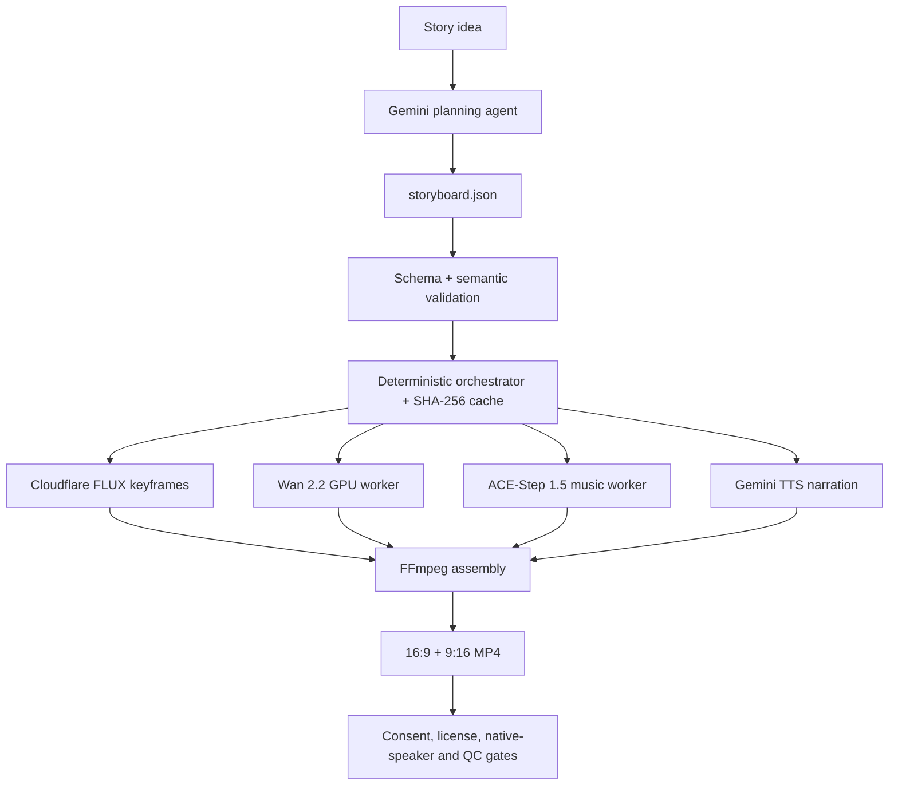

# AI Content System — Storyboard-driven AI filmmaking

A reproducible Python filmmaking pipeline that converts a validated `storyboard.json` into a 60–90 second narrated short film with generated keyframes, Wan 2.2 moving shots (or a documented Ken Burns fallback), an ACE-Step 1.5 instrumental score, Gemini TTS narration, English subtitles, and horizontal (16:9) plus vertical (9:16) MP4 exports.

**Reference project:** *The Last Coffee Ceremony* · **Primary narration language:** Amharic (`am`) · **Subtitle language:** English (`en`). Change these in `storyboard.json` before production.

## Project status and honest boundaries

The repository includes the Python orchestration, validation, cache, provider adapters, local/remote GPU worker entry points, UI, tests, release gates and documentation. The codebase's automated tests are runnable locally. Live generation still requires the operator's Gemini API key, Cloudflare credentials, a reachable Wan GPU worker and a running ACE-Step API server. Model weights are intentionally not stored in Git.

The application automates music candidate generation, Gemini audio-fit screening and technical scoring/selection. It runs technical narration checks and a Gemini multimodal screen of audio against the script and English subtitles. **A fluent native speaker must still listen to every narration line and attest to pronunciation, meaning and subtitle accuracy.** The challenge explicitly requires this; the software does not fabricate a human review.

## Architecture at a glance



Every stage reads the same storyboard contract. Generated artifacts are stored below `outputs/`, keyed by their input hash; unchanged stages can be reused. Model calls are appended to `runs.jsonl`.

## Requirements

- Python 3.11 or 3.12.
- FFmpeg and ffprobe available on `PATH`.
- Gemini API key from Google AI Studio.
- Cloudflare account ID and Workers AI API token.
- Wan 2.2 TI2V-5B GPU runtime (recommended single GPU class: 24 GB VRAM; multi-GPU configurations require validation).
- ACE-Step 1.5 API server on a GPU host.
- Internet access from the application host to Google, Cloudflare and the configured GPU worker endpoints.

## Quick start — Windows PowerShell

```powershell
cd ai_content_system
py -3.11 -m venv .venv
.\.venv\Scripts\Activate.ps1
python -m pip install --upgrade pip
pip install -e ".[all]"
Copy-Item .env.example .env
```

Edit `.env` and set the real credentials and worker endpoints. **Do not paste API keys into source files, storyboard JSON, screenshots, GitHub issues or commits.** The application loads `.env` automatically via `python-dotenv`.

```powershell
ai-content validate storyboard.json
streamlit run ui/app.py
```

For a quick validation of the included example:

```powershell
ai-content validate examples/storyboard.example.json
pytest -q
```

## Provider configuration

| Variable | Purpose |
|---|---|
| `GEMINI_API_KEY` | Gemini storyboard planning and TTS authentication |
| `GEMINI_TEXT_MODEL` | Storyboard planning model (default `gemini-3.8-flash`) |
| `GEMINI_TTS_MODEL` | TTS model (default `gemini-3.8-flash-tts`) |
| `GEMINI_TTS_VOICE` | Prebuilt voice (default `Kore`) |
| `CLOUDFLARE_ACCOUNT_ID` | Cloudflare account identifier |
| `CLOUDFLARE_API_TOKEN` | Workers AI token with inference permissions |
| `CLOUDFLARE_IMAGE_MODEL` | FLUX.2 Klein 9B model ID |
| `VIDEO_WORKER_URL` | HTTPS URL of remote Wan worker (recommended for Kaggle/Colab) |
| `VIDEO_WORKER_TOKEN` | Bearer token protecting the remote Wan worker; must match GPU-side `WAN_WORKER_TOKEN` |
| `WAN_REPO_DIR`, `WAN_CHECKPOINT_DIR` | Used when running Wan locally in the same environment |
| `ACE_STEP_API_URL` | ACE-Step API base URL, local or remote |
| `ACE_STEP_API_KEY` | Optional API key for ACE-Step |

When Wan runs on Kaggle/Colab and the Streamlit application runs on Windows, use `VIDEO_WORKER_URL` and `VIDEO_WORKER_TOKEN`; the app uploads each approved keyframe to the GPU worker. Do not use a Kaggle local path in the Windows application's `VIDEO_GENERATION_COMMAND`.

## GPU worker deployment

### Wan 2.2

In the GPU environment, clone `https://github.com/Wan-Video/Wan2.2`, install its official requirements, and download the Wan2.2 TI2V-5B checkpoint. Set `WAN_REPO_DIR`, `WAN_CHECKPOINT_DIR`, and `WAN_WORKER_TOKEN`. Start the authenticated service:

```bash
pip install -e ".[workers]"
uvicorn workers.wan_server:app --host 0.0.0.0 --port 8787
```

Set the main app's `VIDEO_WORKER_URL` to the private HTTPS/tunnel URL ending at that service and `VIDEO_WORKER_TOKEN` to the same token. Test one shot before launching all 8–12 shots. Wan 2.2 TI2V-5B is GPU-intensive; the official model card documents 720p inference and a 24 GB GPU baseline. If it fails, the orchestrator records the failure and uses a Ken Burns fallback for that shot.

### ACE-Step 1.5

In a GPU environment, install ACE-Step from its official repository and start its API server (`uv run acestep-api`). Configure `ACE_STEP_API_URL` to its private endpoint and optionally `ACE_STEP_API_KEY`. The included `workers/ace_step_worker.py` submits text-to-music tasks, polls task status, downloads the WAV and returns it to the orchestrator. The score prompt incorporates storyboard mood, narration context and timed cue instructions. Three seeded candidates are generated and automatically ranked by duration coverage, loudness and peak headroom.

See [`DEPLOYMENT.md`](DEPLOYMENT.md) and [`workers/README.md`](workers/README.md) for exact deployment steps. See [`docs/LICENSE_REVIEW.md`](docs/LICENSE_REVIEW.md) before completing the release registry.

## User workflow

1. Enter a story idea and generate a Gemini storyboard draft.
2. Review and approve `storyboard.json`.
3. Generate character anchors and keyframes; approve the contact sheet before video inference.
4. Generate video clips; failed clips use the documented Ken Burns fallback.
5. Generate narration and three music candidates. Gemini screens the candidate audio for narrative/cue fit and possible vocals; technical metrics are combined to select a track and save its rationale.
6. Run the automatic narration technical audit. A native speaker listens to every line and records explicit approval; no review-notes field is required because the system writes the technical audit report.
7. Assemble both aspect ratios with narration ducking, subtitles, loudness normalization and AI disclosure.
8. Review model licenses, output rights and consent records; run final release gates and QC.

## Commands

```bash
ai-content validate storyboard.json
ai-content export-schema schema/storyboard.schema.json
ai-content plan "A family reconnects through an Ethiopian coffee ceremony" --language am
ai-content film storyboard.json --output outputs --licenses model_licenses.json --consent consent_registry.json  # Windows / PowerShell
make film   # equivalent shortcut on systems with GNU make
pytest -q
```

The Streamlit UI is the guided production interface. `make film` / `ai-content film` is the end-to-end CLI entry point; it pauses for keyframe inspection and native-speaker attestation rather than bypassing required review gates.

## Outputs

```text
outputs/
  refs/                 character reference images
  keyframes/            per-shot keyframes and approval hashes
  clips/                Wan clips or Ken Burns fallbacks
  checkpoints/          worker checkpoint directories
  music/                candidate_1.wav ... candidate_3.wav
  narration/            per-shot narration WAVs
  assembly/              subtitles_en.srt, horizontal.mp4, vertical.mp4
  narration_review.json automated technical audit + native-speaker attestation
  final_qc.json          ffprobe and deliverable QC
  studio.db              local draft/project state
runs.jsonl               model calls, latency, inputs, outputs and failures
```

## Security and release controls

- `.env`, tokens, consent evidence and generated private family assets must not be committed.
- `consent_registry.example.json` and `model_licenses.example.json` are templates only.
- Release is blocked until every required model/checkpoint license and output-rights review is explicitly completed, consent records exist for real people, native-speaker review is recorded, music is selected, and AI disclosure is enabled.
- Preserve model watermarks/provenance metadata when supplied.

## Documentation

- [`DEPLOYMENT.md`](DEPLOYMENT.md) — Gemini, Cloudflare, Wan and ACE-Step configuration.
- [`docs/LICENSE_REVIEW.md`](docs/LICENSE_REVIEW.md) — model/checkpoint license and output-rights review.
- [`docs/REQUIREMENTS.md`](docs/REQUIREMENTS.md) — functional and non-functional requirements.
- [`docs/SYSTEM_DESIGN.md`](docs/SYSTEM_DESIGN.md) — system architecture and component boundaries.
- [`docs/TECHNICAL_DESIGN.md`](docs/TECHNICAL_DESIGN.md) — modules, contracts, providers, cache and error handling.
- [`docs/END_USER_GUIDE.md`](docs/END_USER_GUIDE.md) — operation and troubleshooting.
- [`docs/DEVELOPMENT_AND_DESIGN.md`](docs/DEVELOPMENT_AND_DESIGN.md) — development process, design rationale and validation.
- [`FINAL_REPORT.md`](FINAL_REPORT.md) — submission report draft; fill in measured outcomes and audience-test evidence.
- `ARCHITECTURE.md`, `DESIGN.md`, `ETHICS.md`, `COSTS.md`, `EXPERIMENTS.md`, `FAILURES.md` — living project evidence.

## Validation status

At packaging time, the included automated suite is run locally. This does not prove live API credentials, Cloudflare quotas, Wan GPU memory fit, ACE-Step service reachability, native-language pronunciation quality or audience acceptance. Record those as actual measured results after deployment; never invent costs, test results or audience feedback.
