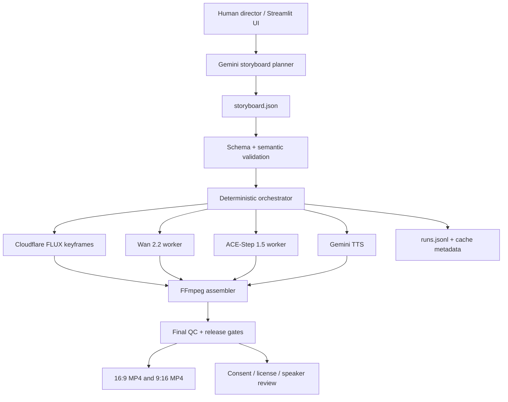

# System Design Specification

## 1. Architectural style

The system uses a deterministic, stage-oriented pipeline with a single JSON contract. Gemini is used as a creative planning/TTS service, not as the runtime controller. A Python orchestrator validates dependencies, computes hashes, invokes providers, records events and resumes successful jobs.

## 2. Logical architecture

## 3. Component responsibilities

- **Streamlit UI:** collects the story brief, presents storyboard/keyframe review, starts generation, displays automated music selection and narration audit, and records required human approvals.
- **Gemini planning adapter:** produces JSON-only storyboard drafts and limited repairs. Drafts remain unapproved until reviewed.
- **Storyboard contract:** declares title, logline, language, subtitles, style, characters, narration voice, music brief/cues, shots and AI disclosure.
- **Validator:** applies JSON Schema and Pydantic/semantic rules, including shot IDs, character references, runtime, language, subtitle and music coverage.
- **Orchestrator/cache:** coordinates stage jobs, retries, stores state and reuses artifacts when dependency hashes match.
- **Visual provider:** calls Cloudflare Workers AI FLUX.2 Klein using multipart requests and reference images.
- **Video worker:** uploads a keyframe to a remote authenticated Wan service or invokes the local official Wan CLI. One shot per job; Ken Burns is the fallback.
- **Music worker:** calls ACE-Step 1.5's asynchronous API, polls task status and downloads generated WAV audio.
- **Music selector:** evaluates duration coverage, average loudness, peak headroom and file integrity; stores the selection, rationale and ranking. This is technical selection, not cultural/aesthetic proof.
- **Narration provider:** sends each shot's text, language, voice and lexicon-expanded text to Gemini TTS; outputs individual WAV files.
- **Narration audit/review:** automatic checks inspect file integrity, duration, loudness, clipping and pacing. A native speaker still attests to pronunciation, translation and subtitle correctness.
- **Assembler:** normalizes clips, extends video where required, joins shots, adds narration and ducked music, burns English subtitles, applies loudness normalization, adds AI end card and exports both aspect ratios.
- **Release gate:** blocks release for missing consent, unreviewed model terms/output rights, missing native-speaker approval, missing music selection/rationale or absent AI disclosure.

## 4. Deployment topology

The desktop host runs Python, Streamlit, the database, Cloudflare/Gemini adapters and FFmpeg. GPU workers may run on the same host or a separate Kaggle/Colab/local GPU host. For remote video generation, the app sends the keyframe and JSON payload to `workers/wan_server.py` over a private authenticated endpoint. The ACE-Step worker calls the ACE-Step API URL directly. Keep GPU endpoints private and token-protected.

## 5. Data flow and artifacts

`storyboard.json` is the immutable creative contract for a run. Generated artifacts and measured facts are stored separately under `outputs/`, not written back into the creative fields except for the explicit music candidate list/selection/rationale required by the challenge. `runs.jsonl` records calls; `.meta.json` sidecars bind artifacts to their input hash; `outputs/studio.db` stores UI drafts and orchestration state.

## 6. Failure handling

- Schema failure: reject the draft before expensive work; Gemini repair is bounded.
- API transient error: retry within a configured budget and log each attempt.
- Quota exhaustion: stop cleanly; retain successful artifacts and resume later.
- Video OOM/worker failure: log failure and create Ken Burns fallback from approved keyframe.
- Music failure: do not silently substitute copyrighted/stock music; stop and report the worker error.
- TTS failure: retain successful per-shot audio and retry only missing/changed lines.
- Assembly/QC failure: preserve intermediate outputs and error details; do not mark release ready.
- Consent/license/speaker review gap: block release.

## 7. Security and ethics

Secrets are environment-only. Real faces/voices require documented informed consent and scoped release permission. Model and output terms are reviewed per exact model/checkpoint version. The AI end card is required, and source provenance/watermarks should be retained. Personal family information should be minimized before sending it to external services.
